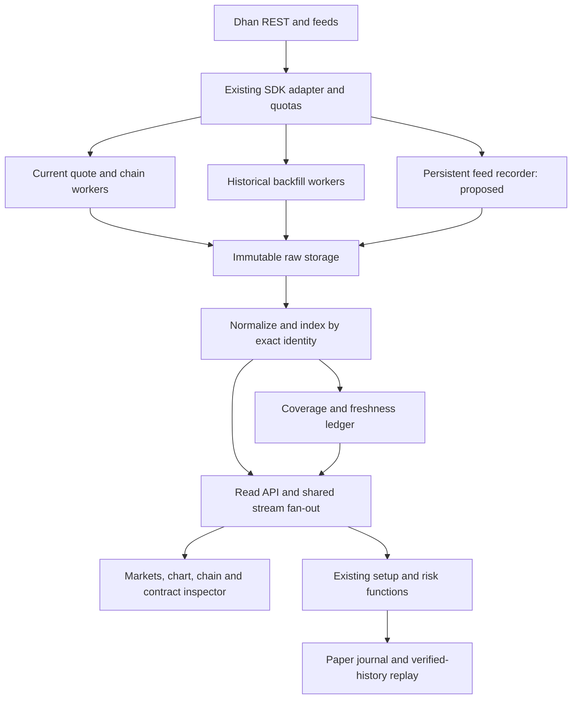

# Theta Plus: all-market data and terminal architecture

Design baseline: 20 October 2026. This is the target architecture, not a statement that all features or data are implemented.

Interactive design source: [terminal-layout-preview.html](terminal-layout-preview.html). It contains terminal, architecture and coverage views, with local-only interactions and no live API connection. Prices are intentionally blank. This preview is documentation; it is not wired into the deployed application.

## Product contract

Build on the existing official DhanHQ-py adapter and Theta Plus deployment. The product should let a user find any supported instrument, inspect its chart and option chain, compare exact contracts, plan rupee risk and retain a paper record in one compact workspace. Do not build another independent trading engine or copy Dhan branding.

The user's priority is **data first, terminal second, validated trading decisions third**. Completion requires a coverage ledger for the selected universe; a large row count or an installed SDK is not completion.

## Scope of “all data”

Three scopes must stay separate:

1. **Catalogue universe:** every row in Dhan's detailed instrument master, including unsupported mappings and expired entries. A catalogue row is metadata, not a price observation.
2. **Provider-accessible market data:** all supported instruments and available intervals/dates, within account entitlement and documented endpoint limits. Provider omissions and rejections remain visible.
3. **Dhan website feature parity:** a product goal requiring a separate source/permission review for each feature. Website features are not automatically available in the public DhanHQ API. News, fundamentals, screeners, corporate actions, international prices and account services must not be presented as connected unless their sources are verified.

This scope does not authorize placing broker orders. Existing broker execution stays disabled. Private account data requires its own requested read-only account view; it is not included in a public all-market database.

## Verified baseline and gaps

| Area | Observed implementation | Required target |
|---|---|---|
| SDK | Official dhanhq 2.3.0 installed and pinned | Keep the adapter; audit upgrades before changing the pin |
| Catalogue | Immutable source CSV and paged documents | Add searchable index, dated listing metadata and change reconciliation |
| Segments | NSE/BSE equity, derivatives, currency, MCX and indices mapped where known | Keep unmapped NSE_M records visible; verify API segment support before adding a mapping |
| Bulk history | Durable jobs, raw responses and daily normalized candle documents | Fair scheduling, recent-data priority, scalable storage, session-aware coverage and bounded retries |
| Current snapshots | A new all-symbol quote job and separate chain job were started | Inspect returned payloads; preserve missing IDs and isolate bad batches |
| Option chains | Collector requests expiry lists and per-expiry snapshots | Discover derivative-bearing underlyings from the master across supported products, including verified commodity mappings; do not request chains for every non-optionable index/stock |
| Chain planner gap | Current collector selects INDEX/EQUITY entries; other instruments are skipped | Resolve actual underlying security ID and segment from option rows; verify MCX/futures-based underlying identity before enabling |
| Live feed | Browser-connected selected subscriptions and ten-second bulk samples | Persistent subscription manager and recorder, subject to feed limits; shared fan-out to multiple browser clients |
| Market board | Small fixed watch list | All-market discovery, user watchlists and exact-instrument detail route |
| Research | NIFTY/BANKNIFTY chart, compact chain, patterns, risk and paper ledger | General instrument context; keep price-pattern and strict evidence eligibility separate |
| Replay | Underlying event-clock replay | Exact-contract option simulation only after verified contract history and fill assumptions |

Last observed production catalogue: **211,945 entries**, fetched 2026-10-20T16:13:32Z. **21,144 NSE_M entries** had an unresolved API mapping. These numbers are observations at that time, not fixed product constants.

History job `017da95145a744058f217e2382631726` remained running. New quote job: `ce3441330a69444c9537e92a2653a997`. New chain job: `14c53baca24b4a7c8d5bcffe63a7d709`. New jobs do not change the old job's immutable catalogue or repair its failed outcomes automatically. Initial quote responses contained empty segment objects; the cause was not established. The chain job returned actual NIFTY expiry lists and multiple chain snapshots, with other requests rejected. None of this establishes full coverage.

## Screen architecture

Use a dense terminal, not a page of large metric cards. The user-supplied Dhan screenshot is the current visual reference: light theme, top navigation, a thin index strip, persistent left watchlist and compact central panels. Home opens a market overview; Trading Room opens the chart/chain/contract layout. No portfolio amounts, market rankings or source data are fabricated in the preview.

| Region | Desktop target | Content |
|---|---|---|
| Header | 40–48 px | Global instrument search; selected exchange; data/session status; token warning |
| Top navigation | Within header | Home, Trading Room, Data Quality and architecture preview; production adds verified market/account routes |
| Index strip | Compact row | NIFTY, next-50, bank index, VIX and other verified index observations |
| Market watch | 165–200 px | Search results/watchlists; symbol, LTP, change and freshness; segment filters |
| Main workspace | Flexible | Chart above, tabbed chain/OI/depth/contract-history below |
| Right inspector | 210–260 px | Exact contract, setup reasons, entry/stop/target, costs, rupee risk, paper action |
| Bottom strip | 24–32 px | Feed state, latest provider timestamps, selected-contract status, open paper risk |

At tablet widths, collapse the market watch and open the right inspector as an explicit side drawer. Preserve chart and table space. At phone widths, use Chart / Chain / Contract tabs; retain the contract identity and freshness strip. Never shrink a desktop table until labels become unreadable. Use horizontal scrolling inside wide data tables only.

Market navigation: **Indices / Equity & ETFs / Futures / Options / Commodities / Currency**. These are views over the same verified instrument identity, not six separate engines. Exchange filters include only verified mappings; unsupported rows remain searchable with their reason.

Selecting an item emits one context: `exchange + segment + security_id + expiry + strike + side + lot_size + master_version`. The chart, chain, inspector and paper draft consume that context. ATM highlighting may change; a selected contract must not change identity until the user selects another one.

## Data-family contract

| Family | Required source and fields | Collection and display contract |
|---|---|---|
| Instrument master | Detailed Dhan CSV; IDs, exchange, segment, instrument, expiry, underlying, strike, side, lot/tick sizes | Daily versioned discovery plus explicit refresh; retain deltas, delistings and unmapped rows |
| Current quotes | Quote API; LTP, last-trade time, OHLC, volume, OI, depth where returned | Batched within provider limits; quote receipt and last trade remain separate timestamps; partial batch is PARTIAL, not full success |
| Active history | Daily and intraday APIs; timestamps, OHLCV and OI where returned | Daily from selected source inception range; intraday 1/5/15/25/60 min within available horizon and 90-day request windows |
| Expired options | Rolling options API; OHLC, strike, OI, IV, spot and volume | Up to documented five-year horizon, 30-day requests; retain rolling selector and returned strike per row; never call it fixed-contract history |
| Chain | Expiry list then each supported expiry; CE/PE identity, LTP, bid/ask, volume, OI, previous OI, IV and Greeks | Store all returned strikes, no ATM-only persistence; the UI may show a bounded window; each expiry has its own observation time |
| Live trades/quotes | Official feed codec and selected subscriptions | Persistent recording is a new service requirement; existing ten-second samples do not satisfy it; retained quotes become stale on disconnect |
| Full depth | Verified 20-/200-level entitlement and exact instrument | Separate subscription budget and timestamp contract; unavailable depth is not synthesized from five-level quotes |
| Derived analytics | PCR, change in OI, spread %, levels, indicators | Inputs, formula version and as-of clock retained; distinguish reported IV/Greeks from eligible fresh values |
| External context | Independently verified event calendar, news, fundamentals or foreign-market source | Separate connector/entitlement and provenance; show NOT_CONNECTED until verified |

OI PCR is sum of PE OI divided by sum of CE OI for the same underlying, expiry and snapshot; zero denominator returns unavailable. Volume PCR uses the equivalent volume sums. Daily delta OI is current minus provider previous OI; it is not automatically an intraday delta series. Spread percentage uses a declared denominator and rejects crossed/invalid books. PCR and IV history require actual timestamped snapshots; no interpolation across missing periods.

## Service boundaries and deployment

Keep the existing Cloud Run web service and GCS bucket during migration. Existing raw responses, candle documents and checkpoints remain readable. Current worker jobs perform the backfill. A proposed continuously running feed recorder needs an explicitly selected runtime that supports its connection lifetime and processing; do not claim that a browser stream or a finite Cloud Run Job already supplies this.

Avoid reading or listing hundreds of thousands of GCS JSON objects per screen request. Add a query index for instrument lookup, series manifests, latest quote pointers, coverage summaries and job outcomes. Store bulk normalized history in partitioned compressed columnar files as volume grows; retain the original raw response keys and checksums. Choose and cost the index service before provisioning it. No additional cloud service is provisioned by this design.

## Scheduling and quota ownership

Use four separately checkpointed lanes: current quotes; option chains; recent closed-candle gaps; long historical backfill. A long daily-history queue must not block every other family. Persistent feed recording has a separate subscription lifecycle and does not replay REST tasks.

The existing worker rotates among running jobs, which lets the new snapshot jobs advance alongside the old history job. It is not yet a per-endpoint distributed quota scheduler. Current collector and provider use conservative common delays; the target is a shared endpoint-specific token bucket across web requests and workers, including per-account daily limits, `Retry-After`, exponential backoff and jitter. Verify configured rates against the current Dhan docs before deployment.

Build chain work from **option-bearing underlying identities**, deduplicate `(underlying segment, underlying security ID)`, fetch actual expiries, then request all strikes for those expiries. Do not waste one API call for each index without options or a checkpoint tick for every option row that is not itself an underlying. For commodity options, underlying futures identity must be verified from the master and provider responses, not guessed from a symbol.

History windows should start with a recent bounded probe per supported instrument/endpoint. Split ranges when a provider size limit is identified. Do not silently convert an ambiguous DH-907 response into permanent unsupported status. Keep a failed-result retry queue and a reason; cap retries and preserve the original failure. Empty quote batches require a smaller isolated probe before attributing the omission to market closure or entitlement.

## Storage identities and migration

| Entity | Key / minimum fields |
|---|---|
| Instrument | Exchange, raw/API segment, security ID, master version; full contract metadata and mapping status |
| Raw response | Request hash, endpoint, sanitized request, received_at, raw checksum, provider result |
| Candle | Series identity, interval, event timestamp, OHLCV/OI; raw reference; ingestion time; revision |
| Rolling candle | Underlying, expiry flag/code, relative selector, side, interval, timestamp and actual returned strike |
| Chain snapshot | Underlying identity, expiry, received_at, provider timestamp if supplied, complete returned strike map |
| Quote | Exact instrument ID, provider fields, last_trade_at, quote_at if actually supplied, received_at, missing-field flags |
| Coverage | Series identity, requested range, returned first/last timestamps, session/calendar version, missing intervals, conflicts, status and raw references |
| Job task | Family, instrument identity, variant, window, catalogue hash, attempt, checkpoint and explicit outcome |
| Paper trade | Existing immutable contract identity, entry/stop/target, sized quantity, costs, setup reasons and manual/hypothetical provenance |

Existing document keys remain compatible. Add an index/import job rather than moving or deleting existing objects. Compare coverage and raw checksums before promoting the new read path. An old job keeps its catalogue manifest; a refreshed master produces explicit delta tasks for new/changed instruments. A new master download alone does not extend a running job.

## Read API target

These routes are proposed, not currently deployed endpoints:

- `GET /api/markets/instruments?q=&segment=&cursor=` — bounded indexed search, including unsupported metadata with reasons.
- `GET /api/markets/instruments/{identity}` — exact master record, latest quote, history/chain/depth capabilities and status.
- `GET /api/markets/candles?...` — bounded normalized range with gap and raw provenance metadata.
- `GET /api/markets/chains?...` — stored all-strike snapshot for exact underlying and expiry.
- `GET /api/markets/coverage?...` — segment/family/series/date coverage, failed/empty/unmapped counts and outstanding task range.
- Shared authenticated stream channel — each browser subscribes to selected identities through server fan-out; no single browser owns the provider connection.

Reuse existing Admin protection for provider mutations, token management and collection control. Reuse the existing read-only research and paper endpoints. Public read responses must not leak token/client secrets or private portfolio data.

## Freshness, eligibility and completion

Each observation keeps event time, ingestion time, clock basis and source. Display MARKET_CLOSED separately from a failure. Inactivity does not prove a disconnection; a connected socket does not prove a fresh quote. Missing exchange quote time remains TIME_UNVERIFIED, even when LTT is recent.

Raw reported Greeks/IV can be retained for audit while a trading decision view hides ineligible values. Do not substitute receipt time for bid/ask time or imply that future VWAP is index VWAP. A snapshot is not continuous history.

Coverage states: NOT_REQUESTED, QUEUED, FETCHING, ROWS_PRESENT_UNVERIFIED, PARTIAL, VERIFIED_RANGE, EMPTY_RETURNED, RETRY_REQUIRED, TOKEN_REQUIRED, PERMISSION_BLOCKED, MAPPING_REQUIRED, PROVIDER_UNSUPPORTED. VERIFIED_RANGE applies only to a specific identity/field/range and a verified calendar, never to an entire universe merely because a job exhausted its tasks.

## Acceptance gates for the complete terminal

1. Any indexed supported instrument can be found by symbol or exact ID; exchange/segment and expiry disambiguate duplicate names.
2. Chart, chain and inspector retain one exact selection during refreshes and late responses; a missing contract is unavailable, not replaced with ATM.
3. Coverage reports requested, returned, missing and rejected work per segment, family and date. Totals reconcile to the selected manifest; catalogue and candle counts are not mixed.
4. Raw returned chain values are checked against sample source responses for NSE, BSE and MCX where supported. No blanket claim of MCX chain support from an INDEX/EQUITY-only planner.
5. Quote partial responses preserve missing IDs; an all-empty batch is diagnosed without calling it a successful all-market quote capture.
6. Live subscriptions reconnect with bounded backoff and resubscribe; multiple browser tabs share a provider subscription; a server-side recorder proves persisted continuity independently of a browser.
7. Freshness and token-expiry/rejection states propagate across every screen; an old successful credential check cannot mask a new failure.
8. Gap repair and catalogue deltas create idempotent tasks; unsupported/permission errors do not erase previously stored history.
9. Underlying replay shares the live rule code, filters future observations and labels known-at-close assumptions. Option P&L remains blocked until exact-contract history and fill assumptions are validated.
10. End-to-end paper flow preserves contract, setup, stop, target, costs and rupee risk. Synthetic QA never pollutes the production paper journal.
11. Desktop and tablet views show chart, compact comparison and contract risk without oversized cards; keyboard navigation and loading/error states remain usable.

## Work order within this architecture

Use the same architecture across implementation; do not introduce a new dashboard for every phase. First audit and repair catalogue mappings, chain discovery, all-empty batches and coverage accounting. Then add the all-market read index and compact terminal shell. Then add shared live ingestion and continuous recording. Finally validate cross-screen research/paper flows and exact-contract replay where data supports them. Existing collection continues throughout.

## Primary references

- Dhan Web features: https://dhan.co/web-trading-platform/
- Dhan trading features: https://dhan.co/trading-features/
- Instrument master: https://dhanhq.co/docs/v2/instruments/
- Historical data: https://dhanhq.co/docs/v2/historical-data/
- Rolling options: https://dhanhq.co/docs/v2/expired-options-data/
- Market quotes: https://dhanhq.co/docs/v2/market-quote/
- Option chains: https://dhanhq.co/docs/v2/option-chain/
- Live feed: https://dhanhq.co/docs/v2/live-market-feed/
- Full depth: https://dhanhq.co/docs/v2/full-market-depth/

Provider limits and website capabilities must be rechecked when implemented. This design does not certify strategy accuracy, whole-market continuity, historical completeness or broker execution readiness.
